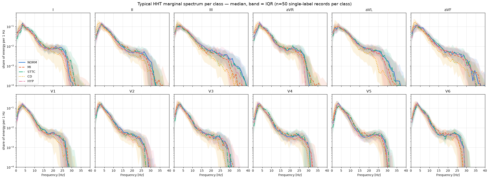
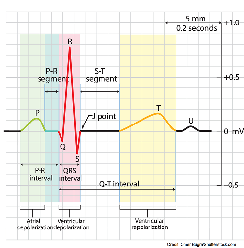
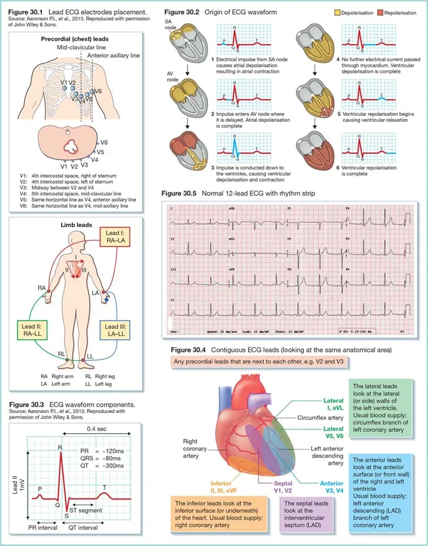

# ECG classification on PTB-XL

A pet project on ECG signal analysis and classification using the
[PTB-XL](https://physionet.org/content/ptb-xl/1.0.3/) dataset: 21,799 clinical
12-lead, 10-second ECG recordings from 18,869 patients.

The goal is to predict the diagnostic superclasses of a record (multi-label):

| Class  | Meaning                 |
|--------|-------------------------|
| `NORM` | Normal ECG              |
| `MI`   | Myocardial infarction   |
| `STTC` | ST/T change             |
| `CD`   | Conduction disturbance  |
| `HYP`  | Hypertrophy             |

The idea is to use the approach from https://github.com/ellkrauze/fault_diagnosis_two_bearings.

## Setup

Requires Python 3.12.

```bash
python -m venv .venv
source .venv/bin/activate
pip install -r requirements/requirements.txt
# for formatting and running tests
pip install -r requirements/requirements-dev.txt
pip install -e .
```

## Data

```bash
./scripts/download_dataset.sh
# metadata + labels only
python ./scripts/clean_dataset.py
# also save signals as X.npy
python ./scripts/clean_dataset.py --signals
# ignore low-confidence SCP statements
python ./scripts/clean_dataset.py --min-likelihood 50
```

Outputs are written to `data/processed/`:

- `metadata.pkl`: cleaned metadata (a pickle keeps dtypes, categories and list columns)
- `labels.csv`: 0/1 targets for each superclass, indexed by `ecg_id`
- `X.npy`: signals, in the same row order as `metadata.pkl` (only with `--signals`)

Cleaning steps in brief:

- Records without a diagnostic label are dropped.
- Age `300` (PTB-XL's anonymisation of patients over 89) is replaced with 90 and flagged.
- Implausible adult heights, weights and BMI values are set to NaN.
- Signal-quality columns become binary `has_*` flags, because NaN there means "no problem noted".
- ID columns (`patient_id`, `nurse`, `site`, …) are stored as categories.

Use the recommended split: folds 1–8 for training, fold 9 for validation and fold 10 for testing.
These folds are already split by patient, so don't reshuffle the records randomly.

## Results so far

Median Hilbert–Huang marginal spectrum per class and lead
(50 single-label records per class; shaded band = interquartile range):



## ECG basics



*Image credit: Omer Bugra / Shutterstock.com.*



*Image source: Aaronson P.I. et al., 2013, figures 30.1–30.5. Figures 30.1 and 30.3 are
reproduced there with permission of John Wiley & Sons.*

### Reading an ECG: normal values and common deviations

Source (in Russian): https://okardio.com/diagnostika/ekg-201.html

| ECG parameter | Normal | Deviations and what they may indicate |
|---|---|---|
| **R–R intervals** | All intervals between R waves are equal | Unequal intervals may indicate atrial fibrillation, extrasystole, sick sinus syndrome or heart block |
| **Heart rate** | 60–90 bpm | Tachycardia: above 90 bpm<br>Bradycardia: below 60 bpm |
| **P wave** (atrial contraction) | Upward arc about 2 mm high, precedes every R wave. May be absent in III, V1 and aVL | Tall (> 3 mm), wide (> 5 mm) or double-humped: atrial myocardial thickening<br>Absent in leads I, II, aVF, V2–V6: the rhythm does not originate in the sinus node<br>Several small "saw-tooth" waves between R waves: atrial flutter/fibrillation |
| **PQ interval** | Horizontal line between P and Q, 0.1–0.2 s | Prolonged (> 1 cm at 50 mm/s): atrioventricular block<br>Shortened (< 3 mm): WPW syndrome |
| **QRS complex** | About 0.1 s (5 mm); each complex is followed by a T wave and a stretch of horizontal line | Widened: ventricular hypertrophy or bundle branch block<br>Tall upward complexes with no gaps between them: paroxysmal tachycardia or ventricular fibrillation<br>"Flag" shape: myocardial infarction |
| **Q wave** | Points down, depth less than ¼ of R, may be absent | Deep and wide Q in limb or chest leads: acute or past myocardial infarction |
| **R wave** | The tallest, points up (about 10–15 mm), sharp, present in all leads | Height varies by lead, but > 15–20 mm in I, aVL, V5, V6 may indicate left ventricular hypertrophy<br>M-shaped notch at the top of R: bundle branch block |
| **S wave** | Present in all leads, points down, sharp; depth 2–5 mm in limb leads | In chest leads its depth may equal the R height but should not exceed 20 mm; in V2–V4 S depth equals R height<br>Deep or notched S in III, aVF, V1, V2: left ventricular hypertrophy |
| **ST segment** | Horizontal line between S and T | Deviation above or below the baseline by more than 2 mm: ischaemic heart disease, angina or myocardial infarction |
| **T wave** | Upward arc, less than ½ of R; in V1 may be as tall as R but not taller | Tall, sharp or double-humped T in limb and chest leads: ischaemia or cardiac overload<br>T merging with the ST segment and R wave into an arched "flag": acute phase of infarction |

## Dataset citation

Wagner, P., Strodthoff, N., Bousseljot, R., Samek, W., & Schaeffter, T. (2022).
*PTB-XL, a large publicly available electrocardiography dataset* (version 1.0.3). PhysioNet.
https://doi.org/10.13026/kfzx-aw45
